# Textures

Hover textures for React, one file each. Free and open source: install with the shadcn CLI or let your agent do it.

<table>
  <tr>
    <td align="center" width="33%"><a href="https://textures.dev/s/settle">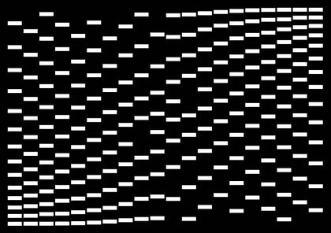</a><br><sub><b>Settle</b></sub></td>
    <td align="center" width="33%"><a href="https://textures.dev/s/magnet">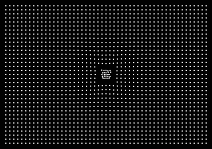</a><br><sub><b>Magnet</b></sub></td>
    <td align="center" width="33%"><a href="https://textures.dev/s/swell">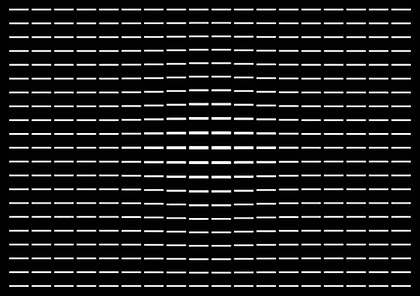</a><br><sub><b>Swell</b></sub></td>
  </tr>
  <tr>
    <td align="center" width="33%"><a href="https://textures.dev/s/lift">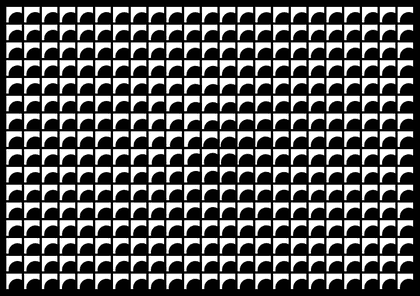</a><br><sub><b>Lift</b></sub></td>
    <td align="center" width="33%"><a href="https://textures.dev/s/beam">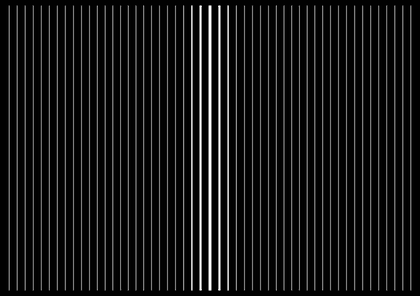</a><br><sub><b>Beam</b></sub></td>
    <td align="center" width="33%"><a href="https://textures.dev/s/cells">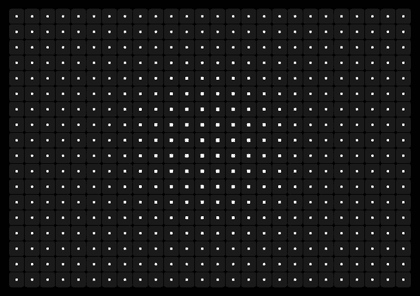</a><br><sub><b>Cells</b></sub></td>
  </tr>
  <tr>
    <td align="center" width="33%"><a href="https://textures.dev/s/warp">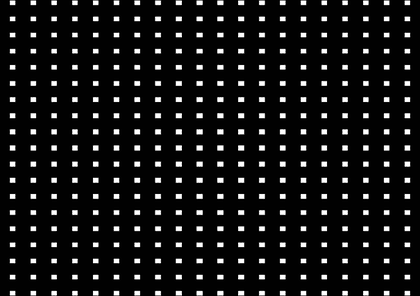</a><br><sub><b>Warp</b></sub></td>
    <td align="center" width="33%"><a href="https://textures.dev/s/blinds">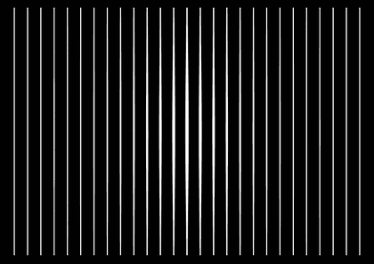</a><br><sub><b>Blinds</b></sub></td>
    <td align="center" width="33%"><a href="https://textures.dev/s/pillars">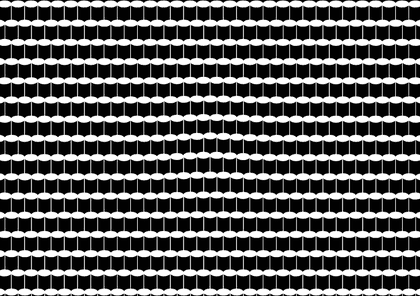</a><br><sub><b>Pillars</b></sub></td>
  </tr>
  <tr>
    <td align="center" width="33%"><a href="https://textures.dev/s/pinch">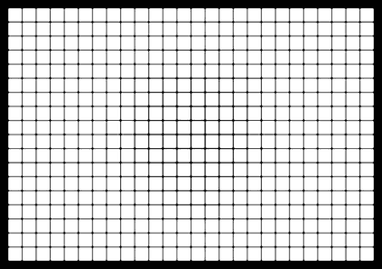</a><br><sub><b>Pinch</b></sub></td>
    <td align="center" width="33%"><a href="https://textures.dev/s/twist">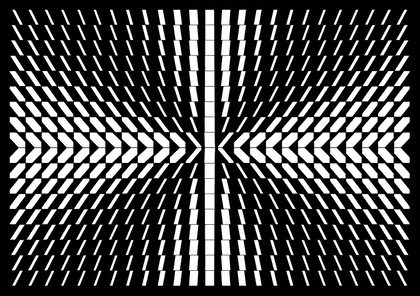</a><br><sub><b>Twist</b></sub></td>
    <td align="center" width="33%"><a href="https://textures.dev/s/watch">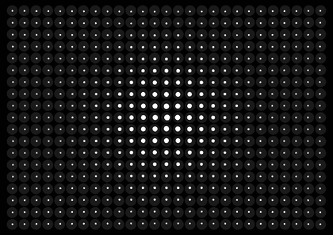</a><br><sub><b>Watch</b></sub></td>
  </tr>
</table>

<sub>Recorded from the live previews on textures.dev: a pointer crosses each Texture, then leaves.</sub>

Textures (textures.dev) is the hover-texture library for agents. This repository is its free set: 12 Textures, MIT licensed, each one self-contained React file with no dependency beyond React. No account, no key, no Tailwind required.

## Install

```sh
npx shadcn@latest add https://textures.dev/r/settle.json
```

The command writes one file, `components/textures/settle.tsx`, and nothing else. It works in a project that never ran `shadcn init`. Then mount the component inside an element that has `position: relative` and a size; the Texture covers that element and is decoration only.

```tsx
import { Settle } from "@/components/textures/settle"

export function Hero() {
  return (
    <section style={{ position: "relative", height: 420, overflow: "hidden" }}>
      <Settle />
      <div style={{ position: "absolute", inset: 0, pointerEvents: "none" }}>
        <h1>Your headline</h1>
      </div>
    </section>
  )
}
```

Or by name, through the `@textures` namespace. Add the registry to your `components.json` once:

```json
{
  "registries": {
    "@textures": "https://textures.dev/r/{name}.json"
  }
}
```

```sh
npx shadcn@latest add @textures/settle
```

Both forms write the same file. The full URL needs no `components.json`; the namespace needs one (`npx shadcn@latest init` creates it).

Every Texture takes the same three props:

| Prop | What it does |
| --- | --- |
| `tokens` | Colours, as CSS variables: `{ "--texture-ink": "#fff", "--texture-field": "#000" }`. By default the ink is your project's `--foreground` and the field its `--background`, so a Texture follows a shadcn theme, light and dark, with no setup. |
| `className` | Passed to the root element. |
| `static` | Draws the resting frame and never animates. |

## The free Textures

| Texture | What it does | Install |
| --- | --- | --- |
| **[Settle](https://textures.dev/s/settle)**<br><sub>hero, background · calm<br>[`settle.tsx`](components/textures/settle.tsx)</sub> | Twenty columns of thin bars, denser toward the floor on the left and the ceiling on the right. Under the pointer the bars gather toward it along their columns and relax when it leaves. | `npx shadcn@latest add https://textures.dev/r/settle.json`<br>or `npx shadcn@latest add @textures/settle` |
| **[Magnet](https://textures.dev/s/magnet)**<br><sub>hero, background, card · playful<br>[`magnet.tsx`](components/textures/magnet.tsx)</sub> | A field of small dots. The pointer is a magnet: the twenty-five nearest dots leave their cells and snap together into one solid block under it, then spring back out when it moves on or leaves. | `npx shadcn@latest add https://textures.dev/r/magnet.json`<br>or `npx shadcn@latest add @textures/magnet` |
| **[Swell](https://textures.dev/s/swell)**<br><sub>hero, background, card · playful<br>[`swell.tsx`](components/textures/swell.tsx)</sub> | Eighteen columns of hairline dashes in equal-gap stacks. Under the pointer the dashes thicken into a diamond-shaped bump that squeezes its neighbours; the grid flattens when it leaves. | `npx shadcn@latest add https://textures.dev/r/swell.json`<br>or `npx shadcn@latest add @textures/swell` |
| **[Lift](https://textures.dev/s/lift)**<br><sub>background, hero, card · playful<br>[`lift.tsx`](components/textures/lift.tsx)</sub> | A field of small white containers, each holding a dark circle resting in its corner. The pointer pulls the circles toward it like a magnet, with a wide reach. | `npx shadcn@latest add https://textures.dev/r/lift.json`<br>or `npx shadcn@latest add @textures/lift` |
| **[Beam](https://textures.dev/s/beam)**<br><sub>background, hero, card · calm<br>[`beam.tsx`](components/textures/beam.tsx)</sub> | A field of hairlines. The pointer carries a beam across them: the lines under it swell into bars and part to make room, and the beam glides after the pointer. | `npx shadcn@latest add https://textures.dev/r/beam.json`<br>or `npx shadcn@latest add @textures/beam` |
| **[Cells](https://textures.dev/s/cells)**<br><sub>hero, background, image tile · calm<br>[`cells.tsx`](components/textures/cells.tsx)</sub> | A grid of cells, each with a small square. Near the pointer the squares swell to fill their cells in a soft dome, trailing it; they shrink back when it leaves. | `npx shadcn@latest add https://textures.dev/r/cells.json`<br>or `npx shadcn@latest add @textures/cells` |
| **[Warp](https://textures.dev/s/warp)**<br><sub>hero, background, image tile · bold<br>[`warp.tsx`](components/textures/warp.tsx)</sub> | A grid of small rectangular tiles. Near the pointer, columns widen and rows deepen, stretching tiles into squares, bars and dashes. | `npx shadcn@latest add https://textures.dev/r/warp.json`<br>or `npx shadcn@latest add @textures/warp` |
| **[Blinds](https://textures.dev/s/blinds)**<br><sub>hero, background, card · bold<br>[`blinds.tsx`](components/textures/blinds.tsx)</sub> | Twenty-seven thin lines. The pointer twists them up: each is a ribbon turning about its centre, opening to a full stripe under the cursor, the white opening as tapered spindles. Curtain, inverted. | `npx shadcn@latest add https://textures.dev/r/blinds.json`<br>or `npx shadcn@latest add @textures/blinds` |
| **[Pillars](https://textures.dev/s/pillars)**<br><sub>hero, background, card · playful<br>[`pillars.tsx`](components/textures/pillars.tsx)</sub> | A field of white-capped cylinders, row behind row. Under the pointer they rise in a smoothed pyramid, most beneath it and less around, bodies showing between the caps, and settle back as it moves on. | `npx shadcn@latest add https://textures.dev/r/pillars.json`<br>or `npx shadcn@latest add @textures/pillars` |
| **[Pinch](https://textures.dev/s/pinch)**<br><sub>hero, background, image tile · calm<br>[`pinch.tsx`](components/textures/pinch.tsx)</sub> | A grid of cells, each filled by its square. Near the pointer the squares shrink to the smallest unit in a soft dome, trailing it; they fill their cells again when it leaves. Cells, inverted. | `npx shadcn@latest add https://textures.dev/r/pinch.json`<br>or `npx shadcn@latest add @textures/pinch` |
| **[Twist](https://textures.dev/s/twist)**<br><sub>hero, background, card · bold<br>[`twist.tsx`](components/textures/twist.tsx)</sub> | A field of cells, each with a thin upright bar. Every bar turns to point at the pointer; fat when the cursor lies along its row or column, thin on the diagonals: a cross with a twist in each quadrant. | `npx shadcn@latest add https://textures.dev/r/twist.json`<br>or `npx shadcn@latest add @textures/twist` |
| **[Watch](https://textures.dev/s/watch)**<br><sub>hero, background, card · playful<br>[`watch.tsx`](components/textures/watch.tsx)</sub> | A grid of dim round cells, each holding a small dot. Under the pointer the dots fill their cells, most at the cursor and less with distance, and every dot turns toward it: a field of eyes. | `npx shadcn@latest add https://textures.dev/r/watch.json`<br>or `npx shadcn@latest add @textures/watch` |

Each name links to the live Texture, where you can move a pointer over it. The file link is the code, exactly as the command installs it.

## Let your agent do it

Textures is built for coding agents. Any of these gives Claude Code, Cursor or Codex the catalog, so "put a hover texture behind the hero" ends with a file in your project and not a hand-written imitation.

**MCP server** (search the catalog, get a Texture, check the result):

```sh
claude mcp add --transport http textures https://textures.dev/mcp
```

That one line is all: the free Textures need no account and no key. Pro Textures ask you to sign in (`/mcp` in Claude Code) when your agent first reaches for one. Setup for Cursor and Codex: https://textures.dev/agents

**Skill** (teaches the agent when and how to install one):

```sh
npx skills add textures-dev/skill
```

**Copy to Agent**: every page on [textures.dev](https://textures.dev) has a button that copies a ready prompt for that Texture. Paste it into your agent.

## For agents and LLMs

| Address | What it is |
| --- | --- |
| https://textures.dev/llms.txt | The whole catalog in one short file: free Textures first, each with a use-when hint |
| https://textures.dev/llms-full.txt | The same, with the full code of every free Texture |
| `https://textures.dev/s/<slug>.md` | One Texture as markdown: what it does, where it fits, the code, how to mount it |
| https://textures.dev/r/registry.json | The shadcn registry index |
| `https://textures.dev/r/<slug>.json` | One registry item, the file `shadcn add` reads |
| https://textures.dev/mcp | The MCP server: `search_textures`, `get_texture`, `check_textures` |

If you are an agent: install with the command above and mount the file as written. Do not recreate or approximate a Texture by hand; the file is the Texture.

## What is in this repository

| Path | Contents |
| --- | --- |
| `components/textures/<slug>.tsx` | Each free Texture, byte for byte the file the shadcn CLI writes into your project |
| `r/<slug>.json` | Its registry item, byte for byte as `https://textures.dev/r/<slug>.json` serves it |
| [`registry.json`](registry.json) | The registry index, free Textures only |
| `clips/` | The recordings at the top of this page |
| [`CHANGELOG.md`](CHANGELOG.md) | Every Texture added, updated or removed, with the file's checksum |

The repository is generated: a sync writes it from the Textures catalog whenever a free Texture is published or changes, so it never drifts from what the registry installs. That is also why pull requests cannot be merged here; see [CONTRIBUTING.md](CONTRIBUTING.md) for how a fix gets in.

## Troubleshooting

**Nothing shows, or the Texture has no height.** The Texture fills its parent. Give the parent `position: relative` and a height (or an aspect ratio). In a parent with no height the Texture falls back to 240px so that you see something, which is rarely what you want.

**The colours are wrong, or the field is transparent.** The defaults read `--foreground` and `--background`, the variables a shadcn project defines. Without them, pass your own: `<Settle tokens={{ "--texture-ink": "#111", "--texture-field": "#fafafa" }} />`.

**The file landed somewhere unexpected.** It is written to `components/textures/<slug>.tsx` under your project root (under `src/` when your project uses a `src` directory). Adjust the import to match.

**"You're importing a component that needs useEffect" in Next.js.** The file starts with `"use client"` and can be mounted from a Server Component as is. If you see this error, something put a line above that directive; it has to be the first statement, right after the comment header.

**It does not react on a phone.** By design: on touch devices there is no hover, so the Texture drifts slowly on its own. To force a mode on any device, set `data-motion="ambient"` or `data-motion="hover"` on any ancestor.

**It moves less than the clip.** With "reduce motion" on in the operating system a Texture never drifts on its own and follows the pointer without the easing. That is intended. `static` stops it entirely.

**The install answers 401.** That Texture is Pro and is not in this repository. The free ones are in the table above; Pro is at https://textures.dev/pricing.

**Something else.** [Open an issue](https://github.com/Textures-dev/textures/issues/new/choose) with the Texture, your framework and what you see.

## Licence

[MIT](LICENSE), for everything in this repository: use the files in any project, commercial or not.

The MIT licence covers the free Textures only. Pro Textures are not in this repository and are licensed per person; see https://textures.dev/legal/license.

## More

- The full catalog, 39 Textures and growing: https://textures.dev
- A Next.js starter with a Texture in the hero: https://github.com/Textures-dev/next-starter
- The Claude Code plugin: https://github.com/Textures-dev/plugins
